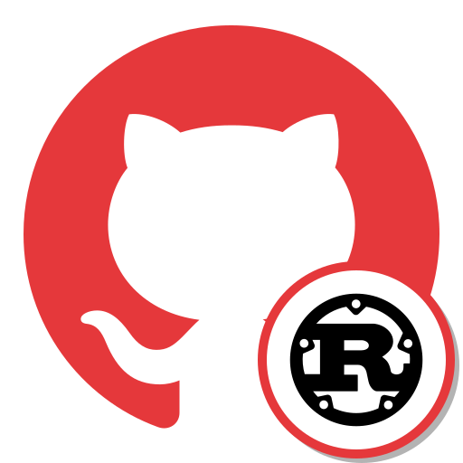
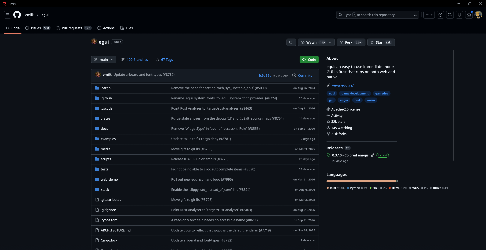
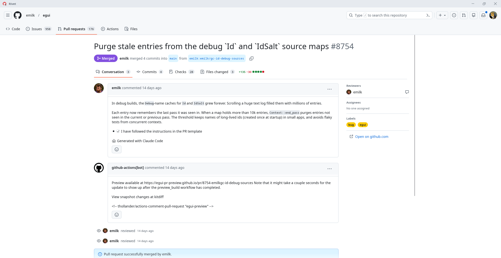
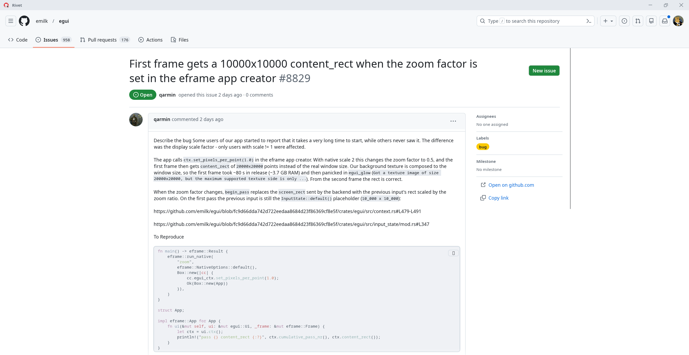
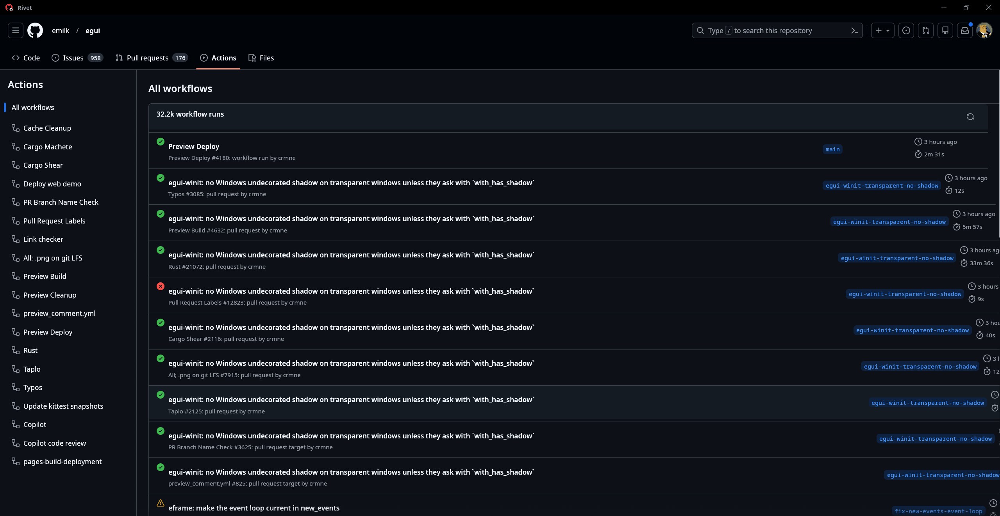

<p align="center">
  
</p>

<h1 align="center">Rivet</h1>

<p align="center">
  <a href="https://github.com/xRookieFight/Rivet/actions/workflows/ci.yml"></a>
  <a href="https://github.com/xRookieFight/Rivet/releases/latest"></a>
  <a href="#license"></a>
</p>

A native GitHub client written in Rust. Rivet follows GitHub's own interface (Primer colors, Octicons, layouts) and talks to GitHub through the REST and GraphQL APIs. There is no web view: every screen is drawn natively with [egui](https://github.com/emilk/egui).

Runs on Windows, macOS, Linux and Android.

## Showcase

<p align="center">
  
</p>

| Pull request | Issue |
| --- | --- |
|  |  |

<p align="center">
  
</p>

## Installing

Grab the archive for your platform from the [latest release](https://github.com/xRookieFight/Rivet/releases/latest):

| Platform | File |
| --- | --- |
| Windows | `rivet-<version>-x86_64-pc-windows-msvc.zip` |
| macOS (Apple silicon) | `rivet-<version>-aarch64-apple-darwin.tar.gz` |
| macOS (Intel) | `rivet-<version>-x86_64-apple-darwin.tar.gz` |
| Linux | `rivet-<version>-x86_64-unknown-linux-gnu.tar.gz` |
| Android | `rivet-<version>-android.apk` |

* **Linux** needs the usual windowing libraries (Wayland or X11) and a Secret Service provider (GNOME Keyring, KWallet) for token storage. Run `packaging/install.sh ./rivet` from the archive to get a launcher and the app icon.
* **macOS** builds aren't notarized yet. If Gatekeeper refuses to open the binary, run `xattr -d com.apple.quarantine ./rivet` once.
* **Android** needs Android 8.0 or newer. Local git isn't available there yet.

## Building from source

```sh
cargo build --release
./target/release/rivet
```

The Android app is a Gradle project in `android/` that builds the Rust library for you; see [CONTRIBUTING.md](CONTRIBUTING.md#android) for the setup.

## Signing in

Pick one on the sign in screen:

* **Sign in with GitHub (OAuth device flow).** Rivet shows a code, you enter it on github.com and approve. Forks can use their own OAuth app (device flow enabled) by building or running with `RIVET_GITHUB_CLIENT_ID=<client id>`.
* **Personal access token.** Scopes: `repo read:org notifications workflow user delete_repo gist`.
* **GitHub CLI.** Reuses the token from `gh auth token` (desktop only).

Tokens are kept in the OS keychain (Keychain, Credential Manager, Secret Service, Android Keystore). Only the login and avatar URL are written to the preferences file. Several accounts can be added and switched from the avatar menu.

## What's in it

* **Dashboard:** top repositories, organizations, contribution graph, pinned repositories, activity feed, inbox summary.
* **Repositories:** file browser, README, About sidebar with languages and releases, file viewer with syntax highlighting and an in place editor that commits directly or to a new branch with a pull request. Branches, tags, releases, commit history and single commit diffs. Star, watch, fork, create, edit settings, change visibility, archive and delete.
* **Issues:** query based filtering, create with issue templates and YAML issue forms, comments, reactions, labels, assignees, milestones, close as completed or not planned.
* **Pull requests:** compare branches, PR templates (including several templates), conversation timeline, commits, checks, changed files, line review comments, approve or request changes, merge with any enabled method, reviewers, draft to ready.
* **Actions:** workflows, runs, jobs and steps, logs with search, manual dispatch with typed inputs, re-run and cancel. Running jobs refresh on their own.
* **Notifications:** inbox with reason and repository filters, mark read, mark done, unsubscribe, jumps straight to the issue, PR or run.
* **Search:** code, repositories, issues, pull requests, users and commits with GitHub's qualifiers.
* **Files tab:** dedicated managers for the README (templates, badges, live GFM preview), issue and PR templates (grouped by kind, YAML forms previewed as forms), and community and config files: LICENSE, CONTRIBUTING, CODE_OF_CONDUCT, SECURITY, FUNDING.yml, .gitignore, .editorconfig, CODEOWNERS, Dependabot and workflows. Labels and branch protection rules have their own screens too.
* **Local git (desktop):** clone, open local repositories, stage and unstage, commit, fetch, pull, push, create, switch, merge and delete branches, manage remotes, history, and a visual merge conflict resolver.
* **Desktop bits:** command palette (Ctrl/⌘ K, accepts `owner/name` or pasted github.com links), GitHub keyboard shortcuts (`/`, `g d`, `g n`, `g i`, `g p`), back and forward history, native file dialogs, light, dark and system themes.

## Development

```sh
cargo test
cargo clippy
```

Debug builds read a few environment variables that make it easy to look at a screen without clicking through the app:

| Variable | Effect |
| --- | --- |
| `RIVET_DEV_TOKEN` | Sign in with this token for the session only, nothing is stored |
| `RIVET_DEV_ROUTE` | Start on a github.com URL, `owner/name`, `local:<path>`, or `dashboard`, `feed`, `notifications`, `settings`, `local`, `new` |
| `RIVET_DEV_THEME` | `light` or `dark` |
| `RIVET_DEV_SHOT` | Save the window to this PNG after a few seconds, then quit |

```sh
RIVET_DEV_TOKEN=$(gh auth token) RIVET_DEV_ROUTE=rust-lang/rust RIVET_DEV_SHOT=shot.png cargo run
```

## Contributing

Bug reports, ideas and pull requests are welcome. [CONTRIBUTING.md](CONTRIBUTING.md) explains the setup and the few rules that keep Rivet close to github.com. Please report security issues privately as described in [SECURITY.md](SECURITY.md).

## Credits

Rivet is an independent project and isn't affiliated with or endorsed by GitHub.

Icons are [Octicons](https://github.com/primer/octicons) (MIT). The app icon combines the GitHub mark with the [Rust logo](https://www.rust-lang.org/policies/media-guide) (CC BY 4.0, Rust Foundation); its source is `assets/icon/rivet.svg`, and `packaging/linux/install.sh` installs it with a desktop entry so Wayland shows it. The bundled fallback font is [Noto Sans](https://notofonts.github.io/) (SIL OFL 1.1). Licenses are next to the files in `assets/`.

## License

Licensed under either of [MIT](LICENSE-MIT) or [Apache License 2.0](LICENSE-APACHE) at your option. Unless you explicitly state otherwise, any contribution you submit for inclusion in Rivet is dual licensed as above, without any additional terms or conditions.
